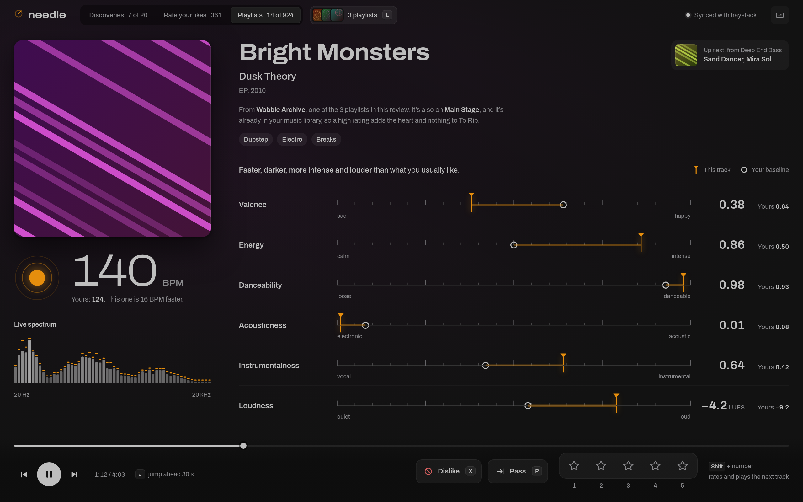

<p align="center">
  <picture>
    <source media="(prefers-color-scheme: dark)" srcset="docs/brand/svg/needle-lockup-on-dark.svg">
    
  </picture>
</p>

<p align="center"><b>Play it. Read it. Judge it.</b></p>

needle is a desktop music player for rating songs, fast. It plays the new music
[haystack](https://github.com/kurtlieber/haystack) finds for your Spotify account, shows you how each song sounds
next to what you usually like, and lets you rate it with a single key. Your ratings go back to haystack, so its
next picks get better.

<p align="center">
  
</p>

- **Three things to review.** This week's **Discoveries** from haystack, **Rate your likes** (the songs you've
  liked in Spotify but never rated), and any of your **Playlists**.
- **See how it sounds.** Tempo, valence (sad to happy), energy, danceability, acousticness, instrumentalness and
  loudness, each shown against your own baseline: "slower, darker and more instrumental than what you usually
  like".
- **Rate without stopping.** `1`–`5` rates the song, `Shift` + a number rates it and moves on, `P` passes, `X`
  dislikes. The music keeps playing while you decide.
- **Works offline.** Ratings wait on your computer until haystack is reachable again.
- **Fits your desktop.** Follows your Omarchy theme, works with media keys and the Omarchy bar, and respects
  reduced motion.

## Contents

- [What you need](#what-you-need)
- [The easiest setup: ask your AI agent](#the-easiest-setup-ask-your-ai-agent)
- [Install](#install)
- [Connect to haystack](#connect-to-haystack)
- [Using needle](#using-needle)
- [Roadmap](#roadmap)
- [License](#license)

## What you need

- **haystack**, running on a server you can reach (a home server, a NAS or a VPS). needle is haystack's
  companion app: it gets the songs and your baseline from haystack and sends your ratings there. If you don't
  have it yet, the next section sets up both.
- **Spotify Premium.** needle plays through librespot, an open-source Spotify client, which needs a Premium
  account. See [License](#license) for what that means.
- **Arch Linux or Omarchy, on Wayland.** needle is built and tested on [Omarchy](https://omarchy.org). Other
  Wayland desktops and other distributions are unsupported (see [Install](#install) and the
  [Roadmap](#roadmap)).

## The easiest setup: ask your AI agent

If you use an AI coding agent that can run commands, such as Claude Code, point it at [AGENTS.md](AGENTS.md):

> Set up needle and haystack for me by following https://github.com/kurtlieber/needle/blob/main/AGENTS.md

It installs needle, sets up haystack on your server (or checks the one you have), and connects the two. A few
steps stay yours, such as signing in to Spotify; the agent gives you those as a short list. AGENTS.md has only
been tested with Claude Code, but any agent that can run shell commands should work.

Prefer to do it yourself? Set up haystack with [its README](https://github.com/kurtlieber/haystack#readme), then
read on.

## Install

### Arch Linux and Omarchy (supported)

```sh
curl -fsSL https://raw.githubusercontent.com/kurtlieber/needle/main/install.sh | bash
```

The script ([read it first](install.sh)) trusts needle's signing key, adds needle's pacman repository, and installs
needle. From then on needle updates with the rest of your system (`sudo pacman -Syu`, or Omarchy's update), and
pacman checks every update's signature. needle shows up in your app launcher.

To do the same steps by hand, or to uninstall, see
[docs/reference.md, "The pacman repository"](docs/reference.md#the-pacman-repository).

### Other distributions (best effort, unsupported)

Each [release](https://github.com/kurtlieber/needle/releases/latest) also has a `.deb` (Debian 13 or later,
Ubuntu 25.04 or later) and an `.rpm` (current Fedora), built automatically. They are provided **as is**: they're
checked only to install and start, and problems that happen only there may not get fixed. Arch Linux and Omarchy
are the only supported platforms.

```sh
sudo apt install ./needle_*_amd64.deb    # Debian, Ubuntu
sudo dnf install ./needle-*.x86_64.rpm   # Fedora
```

They don't update by themselves: install the next release the same way. Check a download against the release's
`SHA256SUMS`.

## Connect to haystack

needle needs two things from haystack: where it is, and its API key.

1. **Where it is.** Create `~/.config/needle/config.toml`:

   ```toml
   [haystack]
   servers = ["http://192.168.1.10:8517"]   # your haystack server; list more than one and needle tries each in turn
   ```

2. **Its key.** Copy haystack's API token into needle's token file:

   ```sh
   (umask 077; mkdir -p ~/.config/needle
    ssh <your server> 'cd ~/haystack && docker compose exec -T haystack haystack token show' > ~/.config/needle/token)
   ```

3. **Spotify.** Start needle. It shows "Sign in to Spotify to play": press `Enter` and sign in in the browser
   window. You only do this once.

If needle says Offline, check that your computer's network is in haystack's `api.allow_networks` and that the
server's firewall allows port 8517. More settings: [docs/reference.md, "Settings"](docs/reference.md#settings).

## Using needle

| Key | Does |
|---|---|
| `1`–`5` | Rate (the song keeps playing) |
| `Shift` + `1`–`5` | Rate and play the next song |
| `P` / `X` | Pass / Dislike (moves on) |
| `Space` | Play or pause |
| `N` / `B` | Next song / back to the previous one (to change your rating) |
| `Tab` | Switch between Discoveries, Rate your likes and Playlists |
| `L` | Choose which playlists to review |
| `?` | Every shortcut |

What a rating does in Spotify (likes, the Discoveries playlist) is up to haystack: see
[How haystack works](https://github.com/kurtlieber/haystack/blob/main/docs/how-it-works.md). Every key, and how
needle behaves offline and with several servers: [docs/reference.md](docs/reference.md).

## Roadmap

**Planned**

- **Rate your own music files.** Review and rate songs from your local music folder, not only from Spotify.
- **Find music by how it sounds.** Search your library or music folder by the seven traits: tempo, valence,
  energy, danceability, acousticness, instrumentalness and loudness.
- **macOS and Android.**
- **Sign haystack in to Spotify from needle,** so setting up haystack's Spotify access is a click instead of a
  copy-and-paste.

**Maybe, later**

- **haystack's settings in needle,** so the common ones can be changed without editing haystack's `config.toml`.
- **The AUR or Omarchy's app list.** needle's own pacman repository works today; a listing there may come later.

**Not planned**

- **iOS.** Apple requires a paid developer account to ship an app. needle and haystack are free and make no
  money, and I don't use iOS, so there's no reason to take that on.
- **Merging needle and haystack.** This is a deliberate design choice. haystack runs headless on one server (a
  VPS, a machine at home, wherever) and is the single source of truth for your ratings. needle runs on as many
  computers as you like, and they all share that one store.

**Unsupported**

- **X11, and desktops other than Omarchy.** needle is Wayland only and is tested only on Omarchy. Other Wayland
  desktops may work, but problems that happen only there may not get fixed.

## License

needle is MIT licensed ([LICENSE](LICENSE)). It bundles the Archivo font (SIL Open Font License) and is built
with open-source Rust crates; [NOTICE](NOTICE) lists them and their licenses.

needle is not affiliated with, or endorsed by, Spotify. It plays through librespot, an open-source Spotify client
that is not Spotify's own, and needs a Spotify Premium account. Spotify's terms may not allow unofficial clients,
so decide for yourself before you use it.

Security reports: [SECURITY.md](SECURITY.md). Working on the code: [docs/reference.md](docs/reference.md) and
[AGENTS.md, "Working on the code"](AGENTS.md#working-on-the-code).
