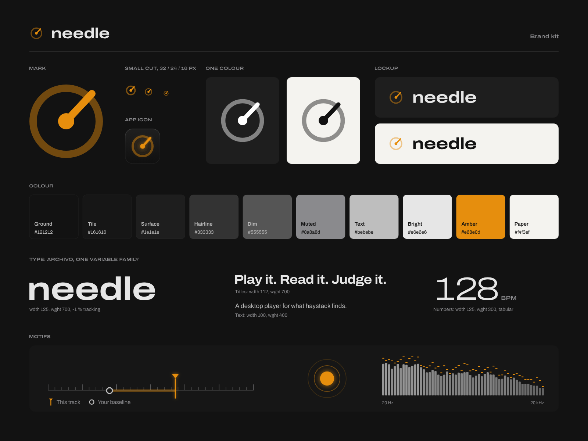

# needle brand kit

<picture>
  <source media="(prefers-color-scheme: dark)" srcset="svg/needle-lockup-on-dark.svg">
  
</picture>

needle plays, reads and judges what haystack finds. Its look is the app's own: matte black, one amber accent,
Archivo, and the scale, needle and Baseline that every Reading is drawn with. This folder holds that look as
files for anything outside the app: sites, READMEs, link previews, slides, stickers, wallpapers.



haystack's kit (in [its `docs/brand/`](https://github.com/kurtlieber/haystack/tree/main/docs/brand)) is built
from this one and shares its ground, type and amber.

## The mark

The wordmark's needle (`Icon.qml`, on a 24-unit grid): a record's edge, the spindle and the tonearm, read as a
dial at the same time. The edge is drawn at 45 %, the spindle and arm at full strength.

- **Amber marks the find.** In both products amber is the needle: the tonearm here, the needle in haystack's
  stack, the marker on a scale. Don't use it for anything else.
- **One colour.** White or black, with the edge at 45 % and the spindle and arm solid.
- **Small sizes.** From 16 to 32 px use the small cut (`needle-mark-small.svg`, `needle-icon-small.svg`): a
  heavier stroke and spindle that hold up on pixels.
- **Clear space.** Round the mark alone, a quarter of its width. Round a lockup, the wordmark's x-height. The
  exported files include it.
- **Minimum size.** The mark at 16 px (small cut), the lockup with the word at 16 px.
- **The name.** Always lowercase, "needle", also in running text. The wordmark is Archivo Expanded Bold.

Don't redraw the arm at another angle, swap the edge's and arm's strengths, recolour the amber, stretch or
outline the mark, or add shadows (the only effect is the app's own glow). On photos or busy grounds, use the app
icon, which brings its own tile.

## Colour

| Name | Hex | Use |
| --- | --- | --- |
| Ground | `#121212` | The background; the word on light grounds |
| Tile | `#161616` | Cards, the icon's tile |
| Surface | `#1e1e1e` | Raised panels |
| Hairline | `#333333` | Rules, a scale's line |
| Dim | `#555555` | Minor ticks |
| Muted | `#8a8a8d` | Secondary text, major ticks |
| Text | `#bebebe` | Body text |
| Bright | `#e6e6e6` | The word, headings |
| Amber | `#e68e0d` | The mark and the find, nothing else |
| Paper | `#f4f3ef` | The light ground |

Dark is the default. On Paper or white the mark stays amber and the word turns Ground.

## Type

Archivo, one variable family (SIL Open Font Licence, in `app/src/fonts/`). All type in the SVGs is outlined, so
they need no font installed.

| Style | Width | Weight | Tracking | Use |
| --- | --- | --- | --- | --- |
| Wordmark | 125 | 700 | -1 % | "needle", big headings |
| Title | 112 | 700 | -2 % | Headlines, taglines |
| Text | 100 | 400 | 0 | Running text |
| Reading | 125 | 300 | -3 %, tabular | Numbers: BPM, scores |
| Label | 125 | 600 | 0 | Labels, in capitals |

The line: **Play it. Read it. Judge it.**

## Files

`svg/` holds the masters, `png/` the same at fixed sizes (lockups, banner and sticker at 2x), `web/` the site
icons.

| File | What it's for |
| --- | --- |
| `needle-mark` | The mark; also `-small`, `-white`, `-black` |
| `needle-mark-animated` | For sites: the arm swings in and settles, then the spindle beats at 120 BPM. Still with reduced motion |
| `needle-icon` | The app icon on its tile, 16 to 1024 px as PNGs; `-small` for 16 to 32 px |
| `needle-wordmark-on-dark`, `-on-light` | The word alone |
| `needle-lockup-on-dark`, `-on-light` | The mark and the word in a row (`Wordmark.qml`) |
| `needle-lockup-stacked-on-dark`, `-on-light` | The mark over the word |
| `needle-and-haystack-on-dark`, `-on-light` | Both products; the same files are in haystack's kit |
| `needle-social` | 1280 x 640 link preview: GitHub's social preview, Open Graph |
| `needle-banner` | 1600 x 400 header for READMEs and sites |
| `needle-wallpaper` | 3840 x 2160; `needle-wallpaper-phone`, 1179 x 2556 |
| `needle-sticker` | A round sticker, 2 in across at 300 dpi; print from the SVG |
| `needle-pattern` | A 480 x 240 seamless tile of scales |
| `needle-brand-sheet` | The sheet above |

### On a site

Copy `web/` to the site's root, then:

```html
<link rel="icon" href="/favicon.ico" sizes="32x32">
<link rel="icon" href="/favicon.svg" type="image/svg+xml">
<link rel="apple-touch-icon" href="/apple-touch-icon.png">
<link rel="manifest" href="/site.webmanifest">
<meta property="og:image" content="https://example.com/needle-social.png">
```

`site.webmanifest` names the two manifest icons and sets the theme colour to Ground.

## Rebuilding

Everything here comes from [`build.py`](build.py), from the app's own geometry and colours:

```sh
python3 docs/brand/build.py
```

It needs `hb-view` (HarfBuzz's utilities) for the type and Chrome or Chromium for the PNGs (set `CHROME` to
pick one). The installed app icon is `app/pkgbuild/needle.svg`; `needle-icon` is the same mark, finished for
stores and sites.
